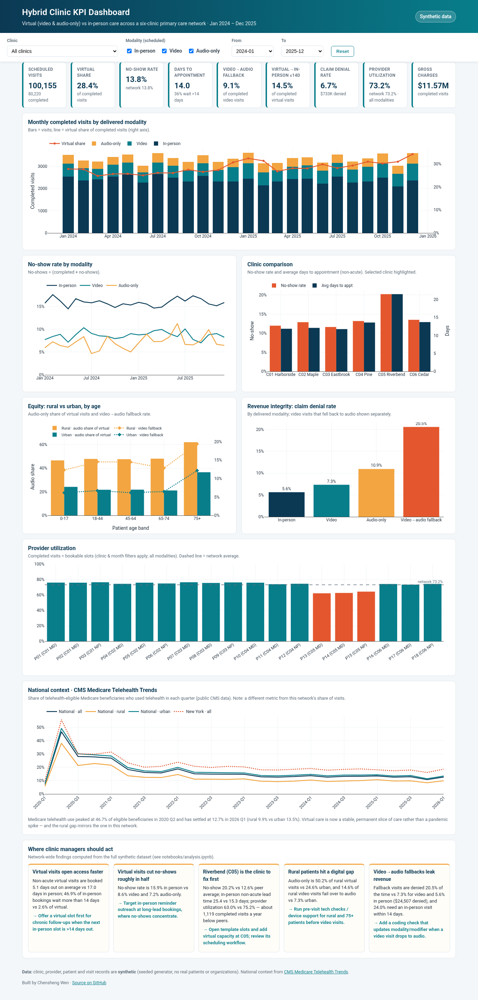
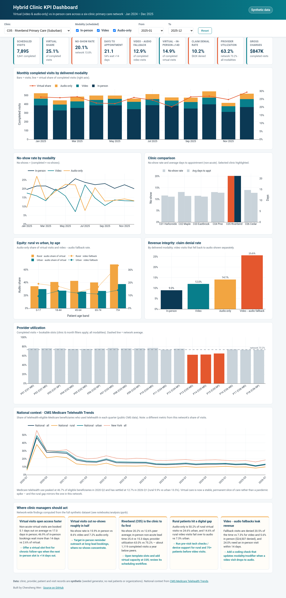

# Hybrid Clinic KPI Dashboard: virtual vs in-person primary care

**A SQL + Python + GitHub Pages project that compares video, audio-only and in-person visits across a six-clinic primary care network on access, attendance, productivity and revenue, using CMS Medicare telehealth data for national context.**

**[▶ Live dashboard](https://wenchensheng.github.io/hybrid-clinic-kpi-dashboard/)** · [Analysis notebook](notebooks/analysis.ipynb) · [KPI SQL](sql/kpi_queries.sql) · [Data quality report](reports/data_quality_report.md)



> **All clinic data in this repo is synthetic.** It comes from a seeded generator ([`src/generate_synthetic.py`](src/generate_synthetic.py)) and describes no real patients, providers or organizations. The only real data is the public CMS Medicare Telehealth Trends file.

## Business question
Most primary care networks now run a hybrid model. For a network of six clinics, **how is virtual care (video and audio-only) performing compared with in-person care on access, attendance, provider productivity and revenue, and where should clinic managers act first?**

National context: CMS data shows Medicare telehealth use peaked at **46.7%** of eligible beneficiaries in 2020 Q2 and has held at about **11–15%** per quarter since 2023 (**12.7%** in 2026 Q1). Rural use is consistently lower than urban (**9.9% vs 13.5%**). Virtual care is a lasting part of operations rather than a pandemic spike, so it needs KPIs like any other service line.

## Key results
These numbers are computed from the synthetic dataset (100,155 clean appointments, Jan 2024 – Dec 2025):

| # | Finding | Evidence | Recommended action |
|---|---|---|---|
| 1 | **Virtual visits open access faster** | Non-acute virtual visits are booked **5.1 days** out vs **17.0 days** in person. **46.9%** of in-person bookings wait more than 14 days vs **2.6%** of virtual ones. | Offer a virtual slot first for chronic follow-ups when the next in-person slot is >14 days out. |
| 2 | **Virtual visits cut no-shows roughly in half** | No-show rate is **15.9%** in person vs **8.6%** video and **7.2%** audio-only. The gap holds within every lead-time band. | Focus reminder outreach on long-lead in-person bookings. |
| 3 | **Riverbend (C05) is the clinic to fix first** | No-show rate **20.2%** vs **12.6%** peer average. In-person lead time **25.4** vs **15.3** days. Provider utilization **63.0%** vs **75.2%**, about **1,119 completed visits/year** below peers. | Open template slots, add virtual capacity and review C05's scheduling workflow. |
| 4 | **Rural patients hit a digital gap** | Audio-only makes up **50.2%** of rural virtual visits vs **24.6%** urban. **14.6%** of rural video visits fall back to audio vs **7.3%** urban, and the 75+ band is highest in both. | Run pre-visit tech checks and offer device support for rural and 75+ patients. |
| 5 | **Video→audio fallbacks leak revenue** | Fallback visits are denied **20.5%** of the time vs **7.3%** video and **5.6%** in person, and **24.0%** need an in-person visit within 14 days. | Add a coding check that updates modality and modifier when a video visit drops to audio. |

Virtual share of completed visits rose from **26.8%** (2024) to **30.1%** (2025).

<details><summary>Filtered view: Riverbend Primary Care (C05), 2025</summary>


</details>

## Data
| Source | What | Where |
|---|---|---|
| **Synthetic** (seeded, `SEED=42`) | 6 clinics (urban, suburban, rural), 18 providers (MD/NP) with daily slot capacity, 15,000 patients (age band, rural/urban, payer), about 101k appointment rows: modality scheduled and delivered, status, lead days, video→audio fallback, in-person follow-up within 14 days, charge, claim denial | `src/generate_synthetic.py` writes to `data/raw/` (regenerated; a 500-row preview is in [`data/sample/`](data/sample/appointments_sample.csv)) |
| **Public: CMS** [Medicare Telehealth Trends](https://data.cms.gov/summary-statistics-on-use-and-payments/medicare-medicaid-service-type-reports/medicare-telehealth-trends) (file `TMEDTREND_PUBLIC_260914.csv`, 2020 Q1 – 2026 Q1) | Share of telehealth-eligible Medicare beneficiaries who used telehealth, by quarter, geography, rurality and age | `src/fetch_cms.py` downloads the file and writes the tidy national + New York subset [`data/external/cms_telehealth_national.csv`](data/external/cms_telehealth_national.csv) (committed so the project also runs offline) |

The generator bakes in realistic, explainable patterns so the analysis has signal to find: shorter lead times and fewer no-shows for virtual visits, higher no-show rates for Medicaid and long-lead bookings, more audio-only use and video failures for rural and 75+ patients, higher denial rates for audio-only and fallback visits, and one under-performing clinic. It also injects a small, known share of data defects (duplicates, nulls, impossible dates, out-of-range values, inconsistent casing) for the cleaning step to catch.

## Approach
1. **Generate.** [`src/generate_synthetic.py`](src/generate_synthetic.py) builds a reproducible synthetic extract plus provider session capacity.
2. **Clean and check quality.** [`src/clean.py`](src/clean.py) checks for nulls, duplicates, invalid or out-of-window dates, date logic, out-of-range values and invalid codes. It repairs fixable issues, quarantines the rest with a reason, and writes [`reports/data_quality_report.md`](reports/data_quality_report.md). Result: 100,978 raw rows → 100,155 clean, 302 duplicates removed, 521 quarantined.
3. **Model and query in SQL.** [`sql/schema.sql`](sql/schema.sql) defines a SQLite star-like schema, and [`sql/kpi_queries.sql`](sql/kpi_queries.sql) holds 9 KPI queries with CTEs and window functions. [`src/build_db.py`](src/build_db.py) loads the tables and saves every query's result to [`reports/kpi/`](reports/kpi).
4. **Analyze.** [`notebooks/analysis.ipynb`](notebooks/analysis.ipynb) is executed with its outputs saved, so the charts render on GitHub. It covers 5 findings plus CMS context and limitations.
5. **Build the dashboard.** [`src/export_dashboard.py`](src/export_dashboard.py) precomputes a compact JSON cube (month × clinic × modality × rurality × age) that feeds [`docs/index.html`](docs/index.html), a static Plotly.js dashboard with clinic, modality and month filters for GitHub Pages. Filters are deep-linkable, e.g. `?clinic=C05&from=2025-01&to=2025-12`.

## KPI definitions
| KPI | Definition |
|---|---|
| Virtual share | (video + audio-only delivered) ÷ completed visits |
| No-show rate | no-shows ÷ (completed + no-shows); cancellations excluded |
| Completion rate | completed ÷ scheduled |
| Days to appointment | days from booking to visit, non-acute visits (avg, median, % > 14 days) |
| Provider utilization | completed visits ÷ bookable slots; fill rate = booked ÷ slots |
| Video→audio fallback | completed video-scheduled visits delivered as audio-only ÷ completed video-scheduled visits |
| Virtual→in-person within 14 days | completed virtual visits followed by an in-person visit within 14 days ÷ completed virtual visits |
| Claim denial rate | denied claims ÷ completed visits (each completed visit = one claim) |
| Equity gaps | the KPIs above split by patient rurality and age band |

## How to run
Requires Python 3.10+.
```bash
python -m venv .venv && source .venv/bin/activate   # Windows: .venv\Scripts\activate
pip install -r requirements.txt
python run_all.py          # or: make all   (about 10 seconds)
make test                  # data-quality, SQL and dashboard consistency tests
make serve                 # open http://localhost:8000
```
Optional headless-browser check and screenshots: `pip install -r requirements-dev.txt && python -m playwright install chromium && make screenshots`.

**Publish the dashboard:** in the GitHub repo, go to *Settings → Pages → Deploy from branch → `main` / `docs`*.

## Project structure
```
hybrid-clinic-kpi-dashboard/
├── run_all.py                  # one-command pipeline
├── Makefile                    # all / test / serve / screenshots
├── data/
│   ├── external/cms_telehealth_national.csv   # tidy public CMS subset
│   ├── sample/appointments_sample.csv         # 500-row preview of clean data
│   ├── raw/  processed/                       # regenerated (git-ignored)
├── src/
│   ├── generate_synthetic.py   # seeded synthetic data generator
│   ├── fetch_cms.py            # CMS download + tidy subset
│   ├── clean.py                # data-quality checks + cleaning
│   ├── build_db.py             # SQLite load + run KPI queries
│   ├── findings.py             # headline findings (shared by notebook/dashboard)
│   └── export_dashboard.py     # JSON for the static dashboard
├── sql/  schema.sql  kpi_queries.sql
├── notebooks/analysis.ipynb    # executed, charts render on GitHub
├── reports/  data_quality_report.md  kpi/*.csv
├── docs/                       # GitHub Pages: index.html, app.js, style.css, data/dashboard.json
├── images/                     # dashboard screenshots
├── scripts/screenshot.py       # headless check: no JS errors + screenshots
└── tests/test_pipeline.py
```

## Limitations
- The clinic data is synthetic, so effect sizes reflect the generator's assumptions, not real operations. The goal is to show the KPI design, SQL, data-quality and storytelling workflow.
- The findings are descriptive, not causal. Modality, visit type and lead time are correlated, and the notebook controls only for lead time.
- The CMS series counts *beneficiaries* who used telehealth, while the network series counts *visits*. Use CMS only as directional context.

## Author
**Chensheng Wen**: healthcare BI / data analyst (SQL, Python, Tableau, Epic Cogito/Clarity/Caboodle certified). GitHub: [@wenchensheng](https://github.com/wenchensheng)

Licensed under the [MIT License](LICENSE).
